<div align="center">

# 🚀 Liftoff

### Your launch video doesn't leave the pad until mission control says go.

**One line of mission in. Launch video directions out. Each one proven against a written definition of done by an independent verifier, before a human ever sees it.**

[Landing page](site/index.html) · [Quickstart](#-quickstart) · [How it works](#-how-a-flight-works) · [Architecture](#-architecture) · [The verifier](#-the-go-no-go-poll) · [Version N+1](#-version-n1-the-team-gets-better) · [Design decisions](#-design-decisions)

<sub>Built for the <b>Done Means Done</b> track of the Recursive Agents Hackathon · Crusoe Managed Inference · NVIDIA Nemotron 3 · You.com</sub>

<br>

<a href="docs/liftoff-demo.mp4">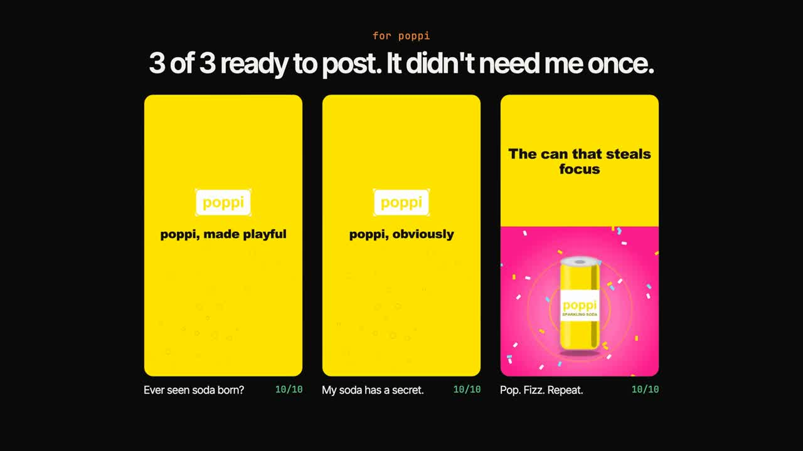</a>

<sub><b>▶ <a href="docs/liftoff-demo.mp4">Watch the 87 second demo</a></b>: a brand URL in, three proven launch videos out, and how it learns.</sub>

<br><br>

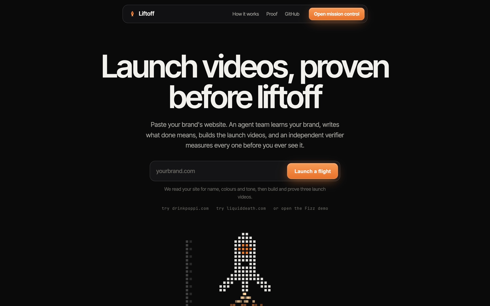

<sub>Paste a brand's website on the landing page, and Liftoff takes it from there.</sub>

<br><br>

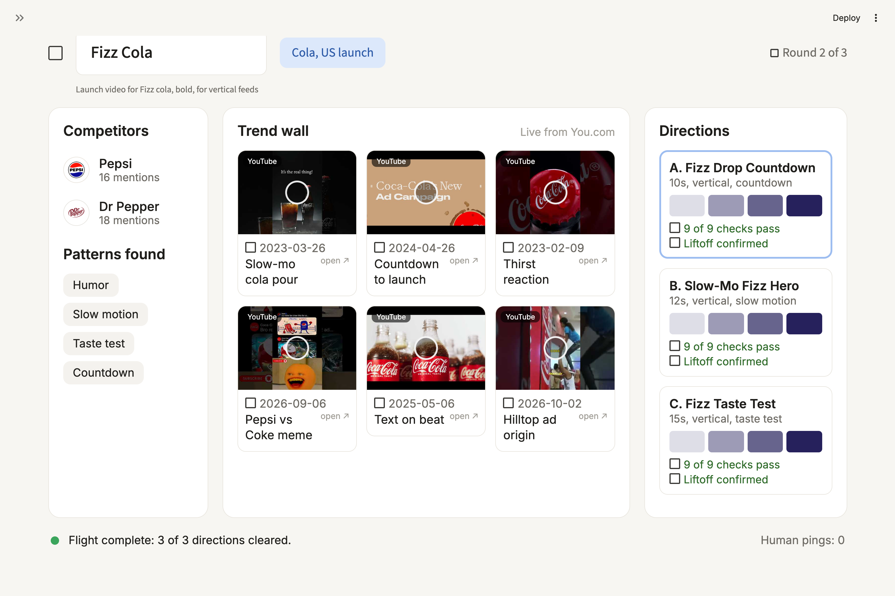

<sub>Mission control: what's viral in the category this month, then the videos Liftoff made and proved.</sub>

<br><br>

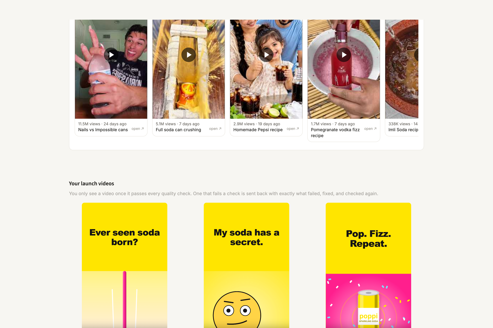

<sub>Further down: the launch videos, each shown only after it passes every check.</sub>

<br><br>

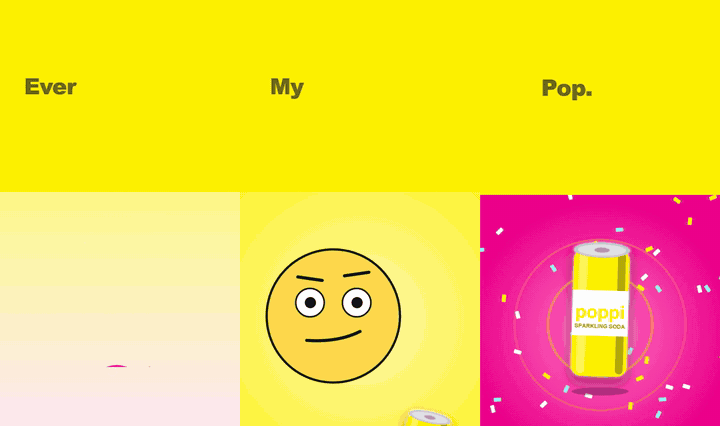

<sub>Three poppi videos animated in Remotion from Liftoff's three ideas, each passing all 10 checks. Full quality: <a href="docs/remotion/poppi_A.mp4">A</a> · <a href="docs/remotion/poppi_B.mp4">B</a> · <a href="docs/remotion/poppi_C.mp4">C</a>.</sub>

</div>

---

## The problem

Ask any AI to "make a launch video" and you get *something*. Whether it is **done** is a vibe. Nobody wrote down what done means, nobody checked, and the same model that made it is the one telling you it's great.

Liftoff fixes that with a team of agents that behaves like mission control:

| | Without Liftoff | With Liftoff |
|---|---|---|
| **Definition of done** | Implied, shifts as you go | Written as executable checks **before** anything is built, then locked |
| **Who checks** | The model that made it | An independent verifier on a **different model family** that never sees the builder's reasoning |
| **How it checks** | "Looks good to me" | `ffprobe`, pixel math, WCAG contrast, template matching. A vision model only for what pixels can't answer |
| **When it fails** | You find out later | **HOLD** with the measured number, sent back to the builder, rebuilt, re-polled |
| **When it's stuck** | It loops forever | Loop detection → strategy switch → **SCRUB** |
| **When it shouldn't decide** | It guesses | **CALL** the human, and the ping is counted on screen |
| **Did it hit the goal?** | Checks passed, goal missed | A final re-check that sees **only** the mission and the frames |
| **Next time** | Same mistakes | The team rewrites its own playbook, kept **only** if held-out missions improve |

---

## 🎬 What it looks like

A real flight on Crusoe. Mission: *"Launch video for Fizz cola, bold, for vertical feeds."*

<table>
<tr>
<td width="40%" align="center">
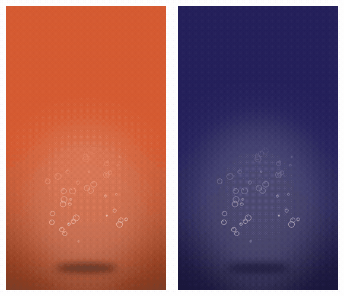<br>
<sub><b>Left:</b> attempt 1, <b>HOLD</b>. Logo on screen <b>2.0s</b> (needs 3.0), text contrast <b>3.8</b> (needs 4.5).<br><b>Right:</b> attempt 2, <b>GO</b>. Logo <b>3.25s</b>, contrast <b>13.32</b>. 9 of 9.</sub>
</td>
<td width="60%">

```text
[  8.9s] librarian tagged     competitors: Pepsi, Dr Pepper
                              patterns: humor, slow_motion, taste_test, countdown…
[ 25.1s] spec      locked     9 checks · 5 assumptions · 0 escalations
[ 37.4s] arbiter   HOLD  A    logo-time-check 2.0 vs >= 3.0s
                              text-contrast-check 3.8 vs >= 4.5
[ 38.0s] director  fix   A    logo_seconds 3.2 · bg secondary
[ 49.1s] arbiter   GO    A    All 9 checks pass on attempt 2.
[ 52.2s] goalcheck       A    Liftoff confirmed.
   …      B, C: HOLD → fix → GO → liftoff confirmed
[123.2s] system    liftoff    3 / 3 cleared · human pings: 0
```

Nobody touched the keyboard after the mission was typed.<br>
Every HOLD carries the **number** that failed and the **threshold** it missed.

</td>
</tr>
</table>

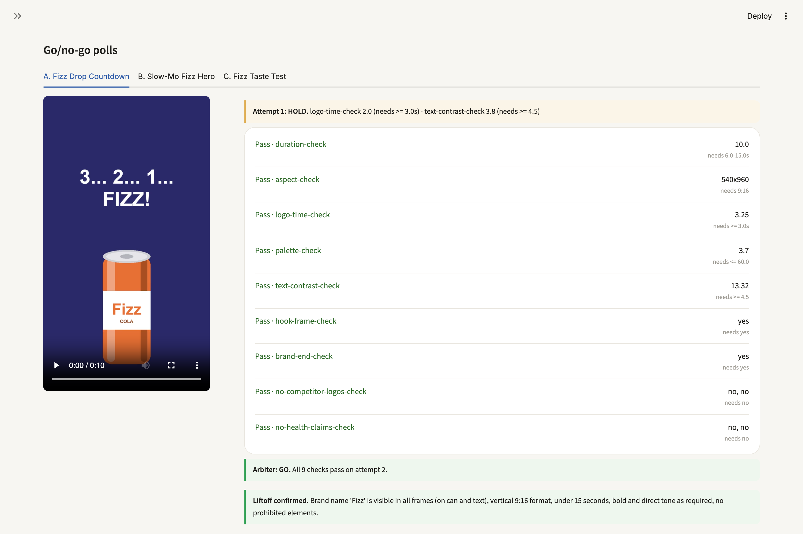

---

## ⚡ Quickstart

**No key needed.** The whole pipeline runs on fixtures, end to end, in about 20 seconds:

```bash
git clone https://github.com/techadnank9/liftoff.git && cd liftoff
python -m venv .venv && source .venv/bin/activate
pip install -r requirements.txt
python scripts/make_assets.py            # draws the fictional brand: Fizz
LIFTOFF_MOCK=1 python -m liftoff.run     # full flight, no network
streamlit run app.py                     # mission control at localhost:8501
```

**Real inference:**

```bash
cp .env.example .env                     # add CRUSOE_API_KEY and YDC_API_KEY
python scripts/check_models.py           # every role's model exists on your account
python -m liftoff.run --mission "Launch video for Fizz cola, bold, for vertical feeds"
python -m liftoff.playbook --rounds 2 --limit 6   # Version N+1 on held-out missions
```

> Requires Python 3.10+ and `ffmpeg` on your PATH. `.env` is read automatically; real environment variables win.

<details>
<summary><b>All commands and flags</b></summary>

| Command | What it does |
|---|---|
| `python -m liftoff.run` | One flight. `--mission`, `--brand fizz`, `--vehicles 3`, `--no-plant` (skip the demo's planted failure) |
| `python -m liftoff.playbook` | Version N+1 loop. `--rounds`, `--limit` missions per split, `--workers`, `--vehicles` |
| `python -m liftoff.library save runs/<id> --url brand.com` | Save a finished flight to `library/` (SQLite index plus videos). Mission control opens saved flights instantly, and a landing page URL that matches one offers it before flying again |
| `python scripts/serve_site.py` | The landing page at `localhost:3000`; mission control runs on `8501` |
| `python scripts/check_models.py` | Lists your Crusoe models and flags any name in `llm.MODELS` that doesn't exist |
| `python scripts/make_assets.py` | Regenerates `assets/fizz/` (can, logo, brand card) |
| `streamlit run app.py` | Mission control. Start flights from the sidebar; it tails `runs/latest` |
| `python -m http.server 3001` | Then open `localhost:3001/site/`, the landing page. Its buttons open mission control (`?mc=<url>` points them elsewhere) and the repo |

| Environment variable | Default | Meaning |
|---|---|---|
| `CRUSOE_API_KEY` | | Crusoe Managed Inference key |
| `CRUSOE_BASE_URL` | `https://api.inference.crusoecloud.com/v1` | OpenAI compatible endpoint |
| `YDC_API_KEY` | | You.com key for live research |
| `LIFTOFF_MOCK` | `0` | `1` = fixtures only, zero network, always works |
| `LIFTOFF_LIVE_RESEARCH` | `1` | `0` = use the research fixture |
| `YOUTUBE_API_KEY` | | optional: real view counts on YouTube posts. TikTok has no public views API, so TikTok tiles show the post date |
| `LIFTOFF_MAX_INFLIGHT` | `8` | Cap on concurrent model calls (Crusoe rate limits by concurrency) |

</details>

---

## 🛰 How a flight works

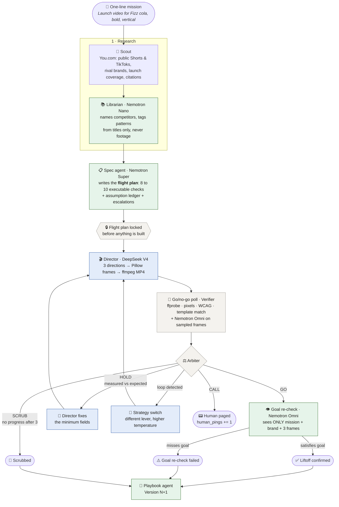

<sub>🟩 Nemotron on Crusoe &nbsp;·&nbsp; 🟦 Director, a different model family &nbsp;·&nbsp; ⬜ deterministic code</sub>

### The agents, one line each

| Agent | Model | Reads | Writes | Never sees |
|---|---|---|---|---|
| 🔭 **Scout** | You.com Search | brand category + market | posts, rivals, citations | |
| 📚 **Librarian** | Nemotron 3 Nano | titles and descriptions | competitors, pattern tags | any video footage |
| 📋 **Spec** | Nemotron 3 Super | mission, brand card, research | flight plan, assumption ledger, escalations | anything the Director makes |
| 🎬 **Director** | DeepSeek V4 Flash | mission, brand, patterns, failing checks | directions + MP4s | the verifier's prompts |
| 🧪 **Verifier** | code + Nemotron Omni | **MP4, brand card, flight plan** | measured value per check | **the direction JSON** |
| ⚖️ **Arbiter** | deterministic code | verdicts, attempt history, escalations | GO / HOLD / SCRUB / CALL | |
| 👁 **Goal re-check** | Nemotron Omni | **mission, brand card, 3 frames** | satisfies goal + reason | **the flight plan, the Director's reasoning** |
| 📖 **Playbook** | Nemotron 3 Super | holds, fixes, goal failures | rules for Director and Spec | held-out missions |

---

## 🧬 One flight, message by message

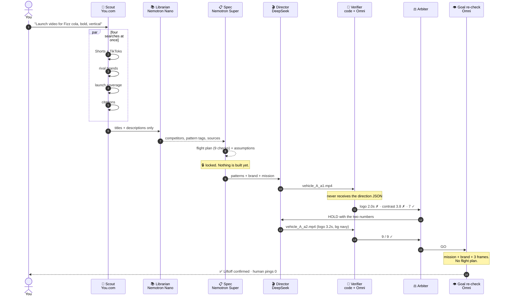

---

## 🏗 Architecture

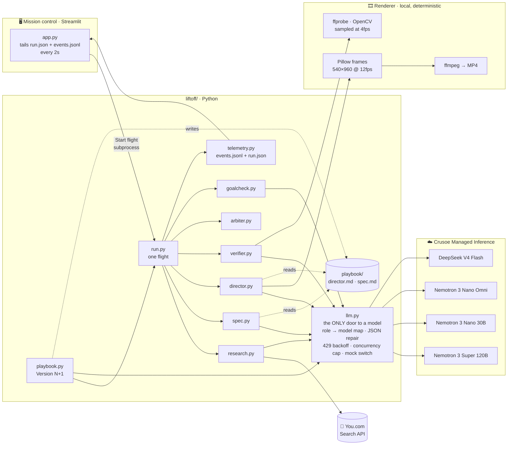

### Model map

| Role | Model on Crusoe | Why this one |
|---|---|---|
| `spec`, `playbook` | `nvidia/NVIDIA-Nemotron-3-Super-120B-A12B` | Best reasoning for writing rules. Thinking is off for Spec: the prompt is strict enough, and it cut the call from 56s to about 25s |
| `librarian`, `scout`, `verifier_text` | `nvidia/NVIDIA-Nemotron-3-Nano-30B-A3B` | Cheap, fast classification of text |
| `verifier_vision` | `nvidia/Nemotron-3-Nano-Omni-Reasoning-30B-A3B` | The verifier's eyes. One frame per question |
| `goalcheck` | `nvidia/Nemotron-3-Nano-Omni-Reasoning-30B-A3B` | Needs 3 images in one prompt. Super is text only on Crusoe; Super VL accepts one image |
| `director` | `deepseek-ai/DeepSeek-V4-Pro` | Writes the creative. Won an 8-model bake-off on Crusoe for copy plus reliable JSON. **A different family on purpose**, so the verifier can't share its blind spots |
| `director_fix` | `deepseek-ai/Deepseek-V4-Flash` | Mechanical field patches after a HOLD, about 2s; also the fallback if the creative reply is unusable |

> Model names live in exactly one place, `llm.MODELS`. `scripts/check_models.py` verifies them against your account.

---

## 🧪 The go/no-go poll

The single most important rule: **deterministic checks decide wherever they can.** A vision model is only asked what pixels can't answer, and only about what one still frame can show.

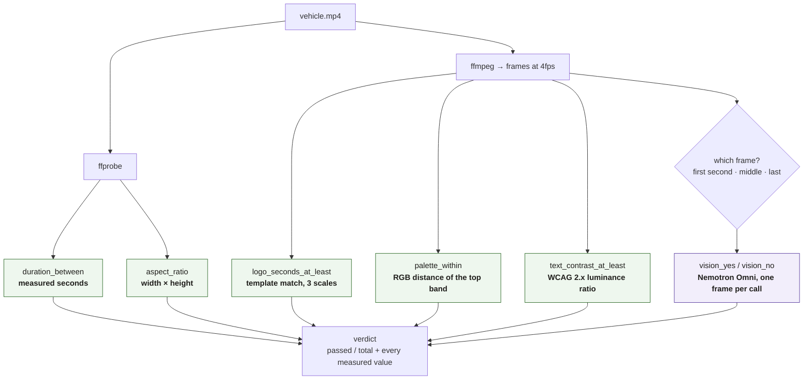

| Check | How it's measured | Real reading from a flight |
|---|---|---|
| `duration_between` | `ffprobe` stream duration | `10.0` s, needs 6 to 15 |
| `aspect_ratio` | `ffprobe` width × height | `540x960`, needs 9:16 |
| `logo_seconds_at_least` | OpenCV template match of the brand logo, frames at 4fps | `2.0` s → **HOLD** · after fix `3.25` s |
| `palette_within` | median RGB of the top 8% vs brand primary/secondary | `3.7`, needs ≤ 60 |
| `text_contrast_at_least` | dominant text vs background, WCAG luminance | white on orange `3.8` → **HOLD** · on navy `13.32` |
| `vision_yes` | Nemotron Omni: *"Is there a readable hook in the first-second frame?"* | `yes` |
| `vision_no` | Nemotron Omni: *"Is a health or medical claim visible in this frame?"* | `no, no` |

> **That contrast failure is a real finding, not a planted one.** White text on the Fizz orange `#D85A30` really is 3.8:1, below WCAG AA. The Director's fix is the right one: move the text onto the navy secondary.

The Spec agent picks the checks, but only from this vocabulary, with exactly these argument names. Anything else is dropped before the plan locks. Vision questions about sound, beats, motion or pacing are forbidden, because a single frame can't answer them. Live testing showed the model asking exactly that.

---

## ⚖️ The arbiter

Four decisions, a reason on every transition, and no model in the loop. The arbiter is deterministic code on purpose: *go* should be a measurement, not an opinion.

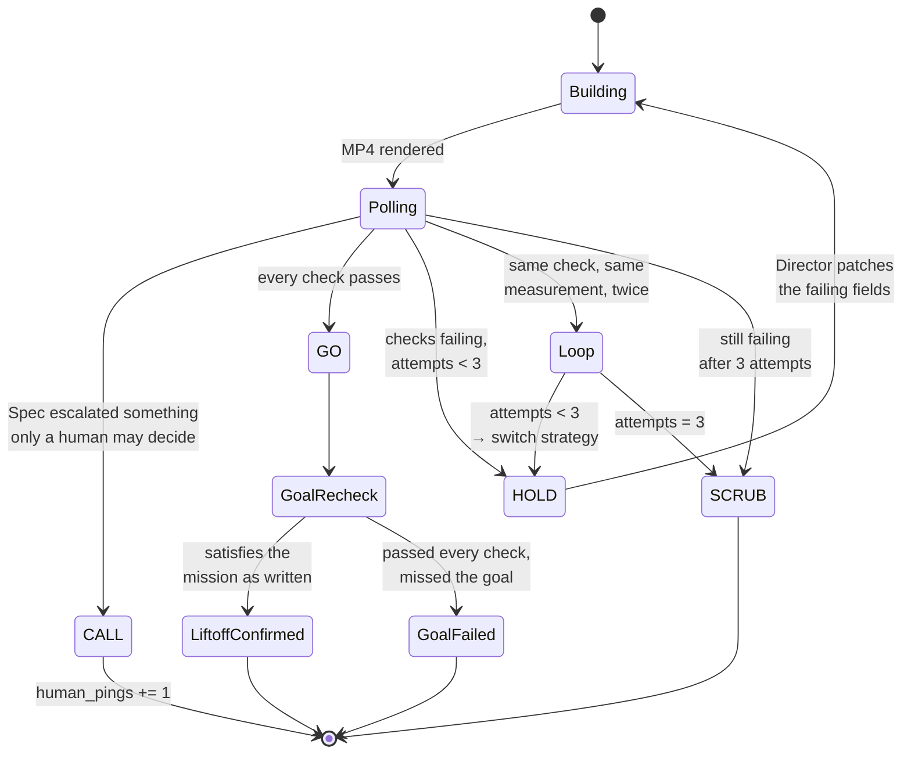

**CALL is rare by design.** The Spec agent may only escalate when building would need a decision an agent must not make: a health, medical or legal claim in the mission, or a brand card with no palette or no name. The brand card is also scanned deterministically, so a card that says *"no palette"* pages a human even if the model forgets to. On the first real run the Spec agent escalated six routine unknowns and every vehicle CALLed. Those are now assumptions in the ledger, said out loud, and the flight keeps moving.

---

## 🔒 Independence: who sees what

The verifier is only worth something if it can't be talked into agreeing. Liftoff enforces the boundaries in code, not in prompts.

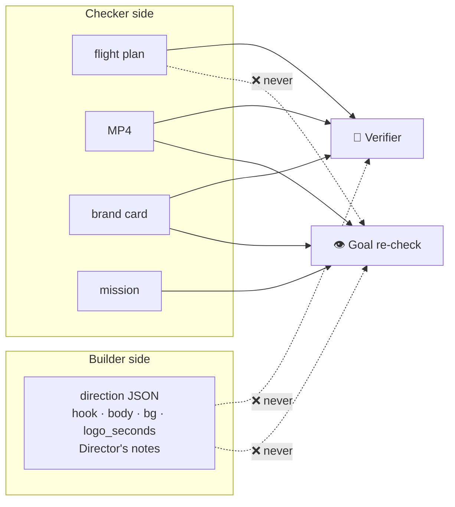

| Boundary | Why it matters |
|---|---|
| Verifier never reads the direction JSON | It can't be told "the logo is on for 3.4s". It has to **measure** it. On the first poll it measured 2.0s when the Director's plan said otherwise. |
| Goal re-check never sees the flight plan | Catches *"passed every predicate, missed the goal"*. In testing it caught a 24-pack announcement that came out as a generic taste test. |
| Director is a different model family | A shared blind spot between builder and checker is the failure this design exists to prevent. |
| Every model call goes through `llm.call()` | One place for the role → model map, JSON repair, retries, rate limits and the mock switch. |

---

## 📈 It learns from every launch (Version N+1)

After a flight, the team reviews itself. A playbook agent reads every HOLD (what failed, the measured number, the fix that cleared it) and every goal re-check failure, then writes rules for the Director and the Spec agent. The change is **kept only if held-out missions improve.**

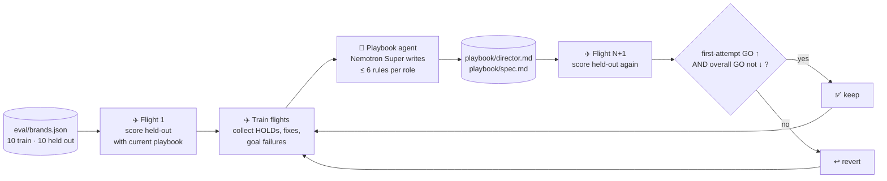

**The score is the first-attempt GO rate on held-out missions**: how often a direction clears every check without a single HOLD. Overall GO rate is a guard, so a rule that trades correctness for speed gets reverted.

**Real run on Crusoe** (`python -m liftoff.playbook --rounds 2 --limit 6`, 6 train and 6 held-out missions, 2 directions each, no planted failures, 14 minutes):

| | Held-out first-attempt GO | Held-out overall GO | Avg attempts | Decision |
|---|---:|---:|---:|---|
| ✈️ Flight 1, empty playbook | **0%** | 100% | 2.00 | baseline |
| ✈️ Flight 2, after 14 train HOLDs | **50%** | 100% | 1.67 | ✅ kept |
| ✈️ Flight 3, after 10 more HOLDs | 50% | 100% | 1.50 | ↩️ reverted: no gain on the score |

The rules the team wrote for itself and kept (`playbook/director.md`):

```text
- logo_seconds must be greater than or equal to 3.25 seconds
- text_contrast must be greater than or equal to 4.5
```

Both came from measured failures: logo time read 2.0 to 2.5s against a 3.0s check (the extra 0.25s covers 4fps sampling), and white on the orange primary measured 3.8 against 4.5. Half the held-out directions now clear on the first draft, and no direction got worse. Flight 3's patch didn't raise the score, so it was thrown away. The keep test does what it says.

Rules must hold for every mission. The first real run learned `duration_s <= 8.0` from a single "under 8 seconds" teaser. That would have broken every 12 second mission, so the playbook prompt now forbids copying one mission's constraint, and the keep test catches it if it slips through anyway.

---

## 🗂 Repository map

```text
liftoff/
├── llm.py           the only door to a model: role → model map, JSON repair, 429 backoff,
│                    concurrency cap, thinking switch, mock switch, .env loader
├── research.py      Scout + Librarian: 4 parallel You.com searches, Nemotron tagging,
│                    fallback to last good result, then fixture
├── spec.py          flight plan + assumption ledger + escalations; vocabulary validation;
│                    deterministic brand card escalations
├── director.py      directions → Pillow frames → ffmpeg MP4; minimal patch on HOLD;
│                    strategy switch on loop
├── verifier.py      ffprobe, OpenCV, WCAG, template matching; Nemotron Omni per frame;
│                    every check in parallel
├── arbiter.py       GO / HOLD / SCRUB / CALL, loop detection
├── goalcheck.py     independent re-check: mission + brand + 3 frames only
├── playbook.py      Version N+1: baseline → train → patch → held-out → keep or revert
├── playbook_files.py  the shared brain every Director and Spec call reads first
├── telemetry.py     events.jsonl + run.json, the only thing the UI reads
├── brand.py         brand card (Fizz is fictional)
├── mock.py          fixtures shaped exactly like real replies
└── run.py           one flight, end to end
app.py               mission control (Streamlit)
eval/brands.json     20 missions: 10 train, 10 held out
scripts/             make_assets.py · check_models.py · save_studio.py
studio/              Remotion project for the hand-animated poppi videos
playbook/            rules the team wrote for itself (kept only if held-out improved)
runs/<timestamp>/    run.json · events.jsonl · vehicle_*.mp4 · verify_*/samples
```

<details>
<summary><b>Telemetry schema</b></summary>

Every agent writes to one flat event stream. The UI is deliberately dumb: it only reads files.

```json
{"t": 37.38, "agent": "arbiter", "event": "decision", "vehicle": "A",
 "payload": {"decision": "HOLD",
             "reason": "Failing: logo-time-check (2.0 vs >= 3.0s), text-contrast-check (3.8 vs >= 4.5).",
             "failing": [...]}}
```

| Agent | Events |
|---|---|
| `scout` | `start`, `you_com`, `cache`, `fixture`, `live_failed_cache`, `live_failed_fallback` |
| `librarian` | `tagged`, `trend_wall` |
| `spec` | `start`, `locked`, `assumption`, `escalation` |
| `director` | `plan_start`, `direction`, `rendered`, `fix`, `strategy_switch` |
| `verifier` | `check`, `poll` |
| `arbiter` | `decision`, `loop_detected` |
| `goalcheck` | `start`, `verdict` |
| `system` | `mission`, `liftoff`, `usage` (tokens per role) |

`run.json` holds the current state: mission, brand, flight plan, assumptions, escalations, research, every vehicle with every attempt and verdict, human pings.

</details>

---

## 🧭 Design decisions

<details>
<summary><b>Why render with Pillow and ffmpeg instead of a video model?</b></summary>

Because "done" has to be checkable. A deterministic renderer means the Director's levers (`logo_seconds`, `bg`, `duration_s`, the copy) map one to one onto what the verifier measures. When the verifier says "logo 2.0s, needs 3.0", the Director can actually fix it, and you can prove it did. A generative video model would turn every HOLD into a reroll, so the main pipeline uses no generative video APIs. The poppi showcase videos in `studio/` are hand animated in Remotion from the Director's ideas and held to exactly the same checks (`scripts/save_studio.py`).

</details>

<details>
<summary><b>Why is the arbiter not an LLM?</b></summary>

GO/HOLD/SCRUB/CALL is a policy over measurements: did every check pass, how many attempts, did the same number repeat. Code does that perfectly and explains itself with the exact numbers. A model here would add latency and a new place to be wrong.

</details>

<details>
<summary><b>Why does the vision model see one frame per question?</b></summary>

Questions are written for a single still: *"Is there a readable hook in the first-second frame?"* The verifier picks the frame by the question's words (first second, middle, last). Questions a frame can't answer, like sound, beat or pacing, are banned in the Spec prompt, because the first live run asked them and the honest answer was always "no".

</details>

<details>
<summary><b>What happens when a provider fails?</b></summary>

| Failure | Behaviour |
|---|---|
| Model rejects `response_format` | retried without it, JSON parsed out of prose, code fences or `<think>` blocks |
| Reply has no JSON | retried; reasoning content used if `content` is empty |
| Crusoe 429 `max_requests_limit` | jittered exponential backoff; all calls share a concurrency cap |
| You.com fails or returns too few posts | last good result for that brand, then the fixture |
| Anything, anytime | `LIFTOFF_MOCK=1` runs the full pipeline with zero network |

</details>

<details>
<summary><b>Bugs real inference found that mocks never would</b></summary>

- Spec escalated six routine unknowns, so every vehicle CALLed. Escalations are now reserved for decisions an agent must not make.
- Spec set the logo threshold at 2.0s, so the planted 2.4s miss sailed through. The core checks are now fixed and cite the research.
- The Director wrote "adjust contrast" into `notes` and changed nothing, a loop. Its fix prompt now names the levers the renderer obeys.
- The goal re-check read the filename `s_0032.png` as "32 seconds long". Frames are now labelled by position.
- The Director never saw the mission, so "Announce Fizz now in 24-packs" came out as a taste test. The goal re-check caught it. The Director now reads the mission.
- `bool("false") == True` would have confirmed liftoff on a "false" from the model.

</details>

---

## 🏁 Done Means Done, line by line

| Track asks for | Liftoff |
|---|---|
| Writes its own definition of done | Spec agent → flight plan of executable checks, **locked before any build** |
| Checks with tests or independent verifiers | ffprobe, OpenCV, WCAG, template matching + Nemotron Omni. **Different model family** from the builder, never sees its output JSON |
| Catches drifting | drift score per vehicle on every card (heuristic today, Nemotron judge next) |
| Catches looping | same check + same measurement twice → strategy switch → SCRUB |
| Continue / re-plan / stop / ping human | **GO / HOLD / SCRUB / CALL**, with the measured reason on every transition |
| One-line goal, walk away | mission in, verified vehicles out, **human pings counted on screen** |
| Asset satisfies the goal, not just the checks | independent goal re-check with mission + frames only |
| Gets better over time | Version N+1 playbook, **kept only if held-out missions improve** |

## 🤝 Sponsors

- **Crusoe Managed Inference**: every model call, through one OpenAI compatible endpoint in `liftoff/llm.py`.
- **NVIDIA Nemotron 3**: Super (Spec, playbook), Nano (Librarian), Nano Omni (vision verifier, goal re-check).
- **You.com**: live competitor discovery, public post URLs for the trend wall, and citations for the Spec agent's thresholds.
- **YouTube Data API**: public view counts for the trend wall (statistics only, no footage).

## 🗺 Roadmap

- [x] Every model call on Crusoe, verified against the account
- [x] Live You.com research with Nemotron pattern tagging and fallbacks
- [x] Real view counts on the trend wall (YouTube Data API, statistics only)
- [x] Parallel verification with a shared concurrency cap
- [x] Loop detection with a Director strategy switch
- [x] Version N+1 playbook scored on held-out missions
- [ ] Drift as a Nemotron judge, HOLD on drift above 0.5
- [ ] Brand card learned from a URL (You.com Contents)
- [ ] Safe zone and caption OCR checks
- [ ] NemoClaw sandbox with network limited to Crusoe and You.com

---

<div align="center">
<sub>Fizz is a fictional brand. Real brands appear only as researched references, linked to their public posts. Nothing is scraped or downloaded.</sub>
</div>
